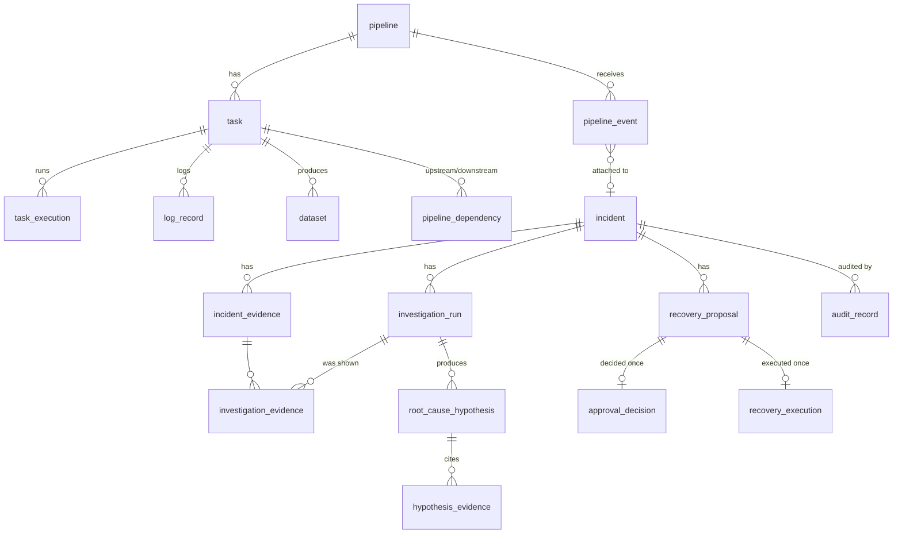

# Data model

The schema is defined in the SQLAlchemy models and created by `migrations/versions/0001_initial_schema.py`. `alembic check` reports no drift. Timestamps are `timestamptz` and IDs are UUIDs, except where noted. Enums are stored as `VARCHAR` with `CHECK` constraints.

## Tables

| Table | Purpose | Key constraints and indexes |
|---|---|---|
| `pipeline` | Pipeline registry | `UNIQUE(key)` |
| `task` | Tasks within a pipeline; `resource_key` names the simulated dependency | `UNIQUE(pipeline_id, key)` |
| `dataset` | Datasets, their producing task and staleness | `UNIQUE(key)`, index on `producer_task_id` |
| `pipeline_dependency` | Task-level directed edge (may cross pipelines) | `UNIQUE(upstream, downstream)`, `CHECK(upstream <> downstream)`; the application rejects cycles under an advisory lock |
| `task_execution` | Run history | `UNIQUE(task_id, run_id, attempt)`, `CHECK(attempt >= 1)`, `CHECK(finished >= started)`, index `(task_id, started_at)` |
| `log_record` | Log lines | Generated `tsvector` column with a GIN index, `CHECK(length <= 8192)` |
| `pipeline_event` | Ingested events and their processing status | `UNIQUE(source, event_id)`, `payload_hash`, indexes on status, `(pipeline, occurred_at)`, task and incident |
| `outbox_message` | Transactional outbox | Partial index on `available_at WHERE published_at IS NULL` |
| `incident` | Incident aggregate; `number` (identity) gives `INC-n`; `version` is the optimistic lock | **Partial unique index** on `fingerprint WHERE status IN (active)`; index `(status, opened_at)` |
| `incident_evidence` | Immutable evidence items with per-incident codes | `UNIQUE(incident_id, code)`, `UNIQUE(incident_id, source_ref)` (idempotent collection), GIN `tsvector` |
| `investigation_run` | One investigation attempt, with result JSON, validation issues and tool calls | Partial unique index: one `PENDING`/`RUNNING` run per incident; confidence range check |
| `investigation_evidence` | The exact evidence presented to a run | PK `(run_id, evidence_id)` |
| `root_cause_hypothesis` | Ranked hypotheses for a run | `UNIQUE(run_id, rank)`, confidence range check |
| `hypothesis_evidence` | Supporting and contradicting links | PK `(hypothesis_id, evidence_id, relation)` |
| `recovery_proposal` | Typed action proposal | Partial unique index: one in-flight proposal per incident (`PENDING_APPROVAL`, `APPROVED`, `EXECUTING`); `CHECK(expires_at > created_at)`; records `incident_version` and `evidence_hash` |
| `approval_decision` | A human decision | `UNIQUE(proposal_id)`; `decided_by` must be non-empty |
| `recovery_execution` | Simulated execution with preconditions, output, postcondition and error | `UNIQUE(proposal_id)` |
| `audit_record` | Append-only audit trail (bigint identity ID) | `UNIQUE(hash)`, `prev_hash` chain, indexes on incident, entity and action; triggers block UPDATE, DELETE and TRUNCATE |
| `api_principal` | Demo identities | `UNIQUE(name)`, `UNIQUE(key_hash)` |
| `sim_resource`, `sim_fixture` | Simulator state: the only "infrastructure" an action can change | — |

## Fingerprints (incident deduplication)

| Event | Fingerprint | Category |
|---|---|---|
| `TASK_FAILED` on `p.t` | `p.t:TASK_FAILURE` | `TASK_FAILURE` |
| `LATENCY_ANOMALY` on `p.t` | `p.t:LATENCY_ANOMALY` | `LATENCY_ANOMALY` |
| `DEPENDENCY_FAILED` with `metadata.upstream_task = u.x` | `u.x:TASK_FAILURE` | becomes `DEPENDENCY_FAILURE` |
| `TASK_SUCCEEDED` | never opens an incident; attached as evidence to an active one | — |

Because dependency failures share the upstream task's fingerprint, the order in which events arrive does not matter: they always group into one incident.

## Dependency traversal

`pipelines/graph.py` uses recursive CTEs. Each row carries the path array, and the recursion excludes any node already on the path. It also stops at a maximum depth of 25. As a result, traversal terminates and never reports the origin, even if a cycle is inserted outside the application (there is a test for this). For each task the shortest path is kept, with ties broken by the lexicographically smallest path, so results are deterministic.
